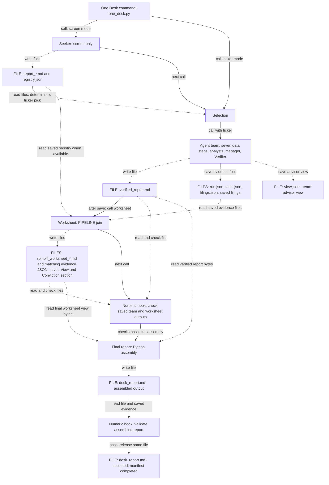

# Checkpoint 3 - Team 9

**Team** - Team 9: Francesco Boscolo Sale, Martin Gee, and Jose Antonio Jijon.

**Client** - Our client is a long-term equity investor seeking positive returns through disciplined stock selection. The desk helps the client identify U.S. companies trading below a conservative estimate of fair value, including overlooked spinoffs. It uses SEC filings to assess whether cash flow can support that valuation, flags risks that could undermine it, and shows which evidence would change the investment view.

## Desk design

Implemented team design, integrated from completed Lab 08 baseline `edc4f08c778fda6617959e41a8064fd0f300f0f7`. Final offline validation: 580 complete tests passed. External network access was blocked. Both assigned partner-company One Desk runs are complete; filing checks and the AMD evaluation are recorded below. PANW's live run is complete; the published Team 9 Lab 09 commit time and permalink are recorded below, and window eligibility is not established.

Fixed orchestration: **Seeker -> Selection -> Agent team -> Worksheet -> Numeric hook -> Final report**. No model chooses the execution order. The seeker is skipped for ticker mode.

Solid arrows show calls, execution sequencing, or release after validation. Dashed arrows show saved-file reads/writes. All run files share one run folder: `runs/desk/<TICKER>_<timestamp>/` by default, or `runs/live/<TICKER>_<timestamp>/` when that output root is selected. The worksheet starts after `verified_report.md` is saved, but takes its filing facts from the saved evidence bundle. `view.json` is the team's advisor view; final assembly reads the worksheet's View and Conviction section directly from its Markdown, rather than substituting that advisor view.

**Deterministic recovery paths.** `--continue` resumes a validated partial run from saved verification evidence at the Worksheet stage; `--finalize` validates and reuses an existing hash-bound worksheet before Numeric hook and Final report; `--replay` validates a completed run and reproduces its final report from saved evidence without fetching or model calls. These paths do not change the normal desk orchestration, and no model chooses their order.

**The joins** - The seeker is a pipeline step for screen input, saving its report and registry for deterministic Selection. In ticker mode, Selection uses the supplied ticker; the run snapshots an existing local registry if available, otherwise an empty registry. The worksheet uses a **PIPELINE** join: the agent team saves evidence in the shared run folder and the worksheet reads those saved files. The numeric hook guards the team report, worksheet skill output, and assembled final report. Final assembly preserves the verified report followed by the worksheet's saved view, with a filing inventory first. A role may quote a skill output file with attribution but must not recompute its numbers. Replay validates saved evidence without fetching missing files or calling SEC/models; missing or changed evidence fails.

**We own** - The factor check: factors, directions, and weights are fixed in `spinoff_factors.txt` before returns are observed, and `factor_check.py` reports the number of valid comparisons actually made. Sparse saved observations do not establish statistical significance.

## Roles

- **Francesco Boscolo Sale - One Desk & Orchestration Lead:** joined pipeline, agent team, fixed execution order, replay, and final-report integration.
- **Martin Gee - Evaluation & Proposal Lead:** three-column comparison, desk diagram, Checkpoint 3 documentation, and evaluation of what the join changed.
- **Jose Antonio Jijon - Skills & Evidence Lead:** seeker, worksheet, numeric guard, and filing/source verification.

## Partner-company runs

Another team assigned NVIDIA (NVDA) and Advanced Micro Devices (AMD) to Team 9. Both completed One Desk and produced final `desk_report.md` files.

| Assigned company | Lab 09 run status | Final report |
| --- | --- | --- |
| NVIDIA (NVDA) | NVDA One Desk: complete | [desk_report.md](evidence/lab09/NVDA/desk_report.md) |
| Advanced Micro Devices (AMD) | AMD One Desk: complete | [desk_report.md](evidence/lab09/AMD/desk_report.md) |

The minimum review subset preserves original file bytes and filing line numbering. Manifests: [NVDA](evidence/lab09/NVDA/desk_manifest.json), [AMD](evidence/lab09/AMD/desk_manifest.json). Full original runs remain local; this subset is for review, not replay or continuation.

## Live record so far

**Team 9 live company: Palo Alto Networks (PANW). Responsible member: Francesco Boscolo Sale.** PANW is separate from the partner-assigned evaluation companies, NVIDIA (NVDA) and Advanced Micro Devices (AMD).

| Company | Ticker | Responsible member | Earnings release / 8-K | EDGAR accepted time | Original frozen view | Desk completion | Commit time | Inside the window | Repository permalink |
| --- | --- | --- | --- | --- | --- | --- | --- | --- | --- |
| Palo Alto Networks | PANW | Francesco Boscolo Sale | November 18, 2026; fiscal Q1 2027 ended October 31, 2026; 0001327567-26-000030 | 2026-11-18 16:37:04 Eastern | 2026-11-22T21:42:46.511055+00:00 (16:42:46.511055 Eastern) | Complete; exact completion timestamp not recorded | 2026-11-22 17:16:01 Eastern | NOT ESTABLISHED | https://github.com/Martingee123/MasteringAI-Desk/blob/1b9d3113aa6d4911faee11b74960235b8820acb5/CHECKPOINT-3.md |

Saved evidence: [final desk report](evidence/lab09/PANW/desk_report.md), [completed manifest](evidence/lab09/PANW/desk_manifest.json), [verified report](evidence/lab09/PANW/verified_report.md), [final worksheet](evidence/lab09/PANW/spinoff_worksheet_20261122_164308_061762_2a308f0d.md), [frozen view](evidence/lab09/PANW/view.json), [accepted-time metadata](evidence/lab09/PANW/filing_time.json), [earnings release](evidence/lab09/PANW/earnings_release.txt), and [8-K](evidence/lab09/PANW/8-K.txt). Original final-report path: `runs/live/PANW_2026-11-22_16-40-43_157876/desk_report.md`.

The release date and quarter are stated in `earnings_release.txt`, line 7. `8-K.txt`, lines 37–39, identifies Item 2.02 and Exhibit 99.1. `filing_time.json` records acceptance with no filing-time override; `view.json` records the actual original view time, after release. No claim of selection before release or timely window compliance is made. No explicit applicable Lab 09 commit window is established by the locally available rules, so inside-window status remains NOT ESTABLISHED; a later commit alone cannot establish eligibility.

The manifest's `status: completed` records successful finalization after worksheet and final-report numeric checks. All 111 recorded evidence hashes, all 19 verification-artifact hashes, saved worksheet/report/view references, and exact final-report composition were inspected and match. The first line equals the manifest's complete filing inventory. The local registry has no evidenced PANW spinoff; all spinoff-specific worksheet sections are not applicable. No checks or workflows were rerun for this documentation audit. No exact final completion timestamp is saved; command-start and worksheet-generation times are not substituted for it. The byte-identical review subset is not a complete replay archive.

## Lab 09 evaluation

Completed comparison for **Advanced Micro Devices (AMD)**. The three comparison columns are Parts alone, Joined desk, and Filing; Claim and Same / changed identify and classify each row.

All AMD sources below are preserved in [the AMD review subset](evidence/lab09/AMD/). Parts alone includes [verified_report.md](evidence/lab09/AMD/verified_report.md), the [final worksheet](evidence/lab09/AMD/spinoff_worksheet_20261122_160614_392426_7249f54c.md), and saved pre-assembly [facts.json](evidence/lab09/AMD/facts.json), [metrics.json](evidence/lab09/AMD/metrics.json), and [release_lines.json](evidence/lab09/AMD/release_lines.json). Joined desk means [desk_report.md](evidence/lab09/AMD/desk_report.md). Filing citations refer to [10-K.txt](evidence/lab09/AMD/10-K.txt) and [earnings_release.txt](evidence/lab09/AMD/earnings_release.txt). Annual figures are FY2025, ended December 27, 2025; quarterly figures are Q3 2026, ended September 26, 2026. Dollar amounts are USD. Percentages render the saved fractional metrics as percentages.

| Claim | Parts alone | Joined desk | Filing | Same / changed |
| --- | --- | --- | --- | --- |
| annual revenue | $34.639 billion | $34.639 billion | `10-K.txt`, lines 782–785: annual headers, million-dollar units, revenue $34,639m/$25,785m. | Same |
| annual revenue growth | 34.3378% year over year | 34.3378% year over year | `10-K.txt`, lines 782–785: $34,639m / $25,785m - 1; narrative rounds to 34% at line 596. | Same |
| operating income | GAAP $3.694 billion | GAAP $3.694 billion | `10-K.txt`, lines 782–784 and 796. | Same |
| operating margin | 10.6643% | 10.6643% | `10-K.txt`, lines 782–785 and 796: $3,694m / $34,639m; derived annual GAAP margin. | Same |
| net income | GAAP $4.335 billion, including discontinued operations | GAAP $4.335 billion, including discontinued operations | `10-K.txt`, lines 782–784 and 803–805. | Same |
| diluted EPS | GAAP $2.65 in `facts.json`; absent from verified team report | Omitted | `10-K.txt`, lines 782–784 and 812–814: total diluted EPS $2.65; continuing-operations diluted EPS separately $2.61. | Changed — omitted |
| return on average equity | 7.1910% | 7.1910% | `10-K.txt`, line 805 and lines 838–839, 873: $4,335m / average equity of $62,999m and $57,568m. | Same |
| debt/equity including current debt | 0.0511437×, including current portion of long-term debt | 0.0511437×, same definition | `10-K.txt`, lines 838–839, 858, 861, 873: ($2,348m noncurrent + $874m current) / $62,999m equity. Excludes other short-term borrowings and leases. | Same |
| free cash flow | $6.735 billion; desk definition of CFO less capital expenditure | $6.735 billion; same definition | `10-K.txt`, lines 921–923, 943, 945: $7,709m - $974m. Total CFO; not an issuer-adjusted/non-GAAP FCF claim. | Same |
| quarter revenue | $13.377 billion, Q3 2026 | $13.377 billion, Q3 2026 | `earnings_release.txt`, lines 19–22: GAAP table, quarter headers, explicit `($M)` scale; lines 138–142 confirm quarter end. | Same |
| quarter GAAP diluted EPS | $1.46 in `release_lines.json`; absent from verified team report | Omitted | `earnings_release.txt`, lines 19–21, 29: GAAP Q3 2026 diluted EPS $1.46; lines 138–141, 169 confirm period and total diluted EPS. | Changed — omitted |
| the view | Team: Buy. Worksheet: not computed, conviction LOW. | Both retained: Buy, followed by worksheet not computed / LOW. | `10-K.txt`, lines 785, 796, 805, 858, 861, 873 support financial inputs, not the Buy judgment itself. Line 928 reports combined depreciation/amortization, not standalone depreciation required by the saved worksheet calculation. | Same — both component views/limitations retained |
| the deciding number | Team: revenue growth 34.3378%. Worksheet: low-case value per share not computed. | Both retained unchanged | `10-K.txt`, lines 782–785 support growth; lines 805, 928, 945 identify earnings, combined depreciation/amortization and capital expenditure, but do not establish a computed worksheet low-case value per share. | Same |

The two changed rows are coverage omissions relative to saved pre-assembly component evidence:

- **FY2025 GAAP diluted EPS = $2.65**, supported by AMD `10-K.txt`, lines 782–784 and 814. The filing supports the component value; the joined report omits it.
- **Q3 2026 GAAP diluted EPS = $1.46**, supported by AMD `earnings_release.txt`, lines 19–21 and 29, corroborated by lines 138–141 and 169. The filing supports the component value; the joined report omits it.

Both values were already absent from `verified_report.md`. Final assembly preserves the verified report and worksheet view verbatim; these omissions must not be attributed to final assembly. The worksheet's unavailable valuation and LOW conviction were already present in the standalone worksheet. Every changed row above has been checked against its saved filing evidence.

### Partner filing checks

| Partner company | Core claim checked in final desk report | Saved filing evidence | Result |
| --- | --- | --- | --- |
| Advanced Micro Devices (AMD) | Q3 2026 revenue = $13.377 billion | [earnings_release.txt](evidence/lab09/AMD/earnings_release.txt), lines 19–22: GAAP table and explicit million-dollar scale; lines 138–142 confirm quarter ended September 26, 2026. | PASS |
| NVIDIA (NVDA) | FY2026 revenue = $215.938 billion | [10-K.txt](evidence/lab09/NVDA/10-K.txt), lines 915–920: million-dollar units, year ended January 25, 2026, revenue $215,938 million. | PASS |

### Remaining Checkpoint 3 evidence

The recorded commit time and permalink identify commit `1b9d3113aa6d4911faee11b74960235b8820acb5`, which first published the completed Team 9 Lab 09 implementation and evidence. They identify that committed repository state, not this later documentation-only update. Inside-window eligibility remains NOT ESTABLISHED, and an exact final completion timestamp was not recorded; neither is invented or presented as a pending run. A separate full NVDA comparison is not included here; the completed 13-row evaluation above is for AMD, with a saved-filing core-claim check for each assigned company.
