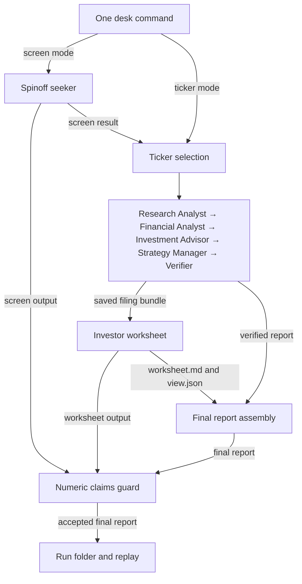

# Checkpoint 3 · Team proposal draft

**Team** — Martin - 0033318978, Jose, and Francesco. Team MJF
**Client** — Our client is a long-term equity investor seeking positive returns through disciplined stock selection. The desk helps the client identify U.S. companies trading below a conservative estimate of fair value, including overlooked spinoffs. It uses SEC filings to assess whether cash flow can support that valuation, flags risks that could undermine it, and shows which evidence would change the investment view.

## Desk design

Proposed design for team review. The agent graph, seeker, worksheet, and numeric guard exist as components. The joined command and final-report replay still need implementation and validation.

**Proposed joins** — The seeker runs as a pipeline step in screen mode. The worksheet runs after the agent team and reads the team's saved filing bundle. Code appends the worksheet's saved view to the verified report. The claims guard checks each skill's numeric output and the assembled report before it is released.

**We own** — [Team to choose the feature it will maintain and demonstrate.]

## Roles

- Martin — [Confirm repository component and responsibility.]
- Jose — [Confirm repository component and responsibility.]
- Francesco — [Confirm repository component and responsibility.]

## Live record so far

Live-run repository permalink pending. This draft has no verified live entries to report.

| Ticker | Release | Filing time | Commit time | Inside the window |
| --- | --- | --- | --- | --- |
| Pending | Pending | Pending | Pending | Pending |
